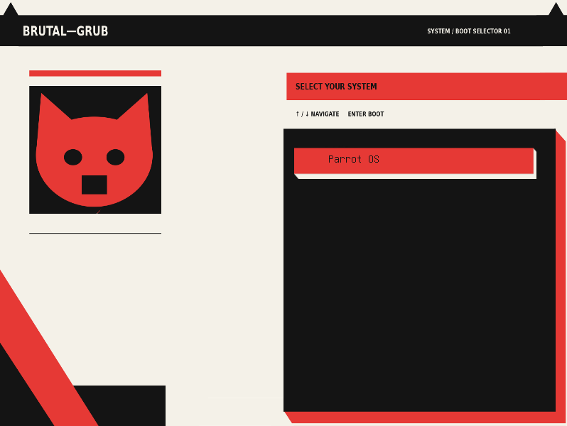

# BRUTAL-GRUB

A neo-brutalist GRUB bootloader theme featuring bold typography, high-contrast colors, and a distinctive minimalist interface.

## Installation

1. Download or clone this repository.
2. Copy the theme directory into `/boot/grub/themes/`.
3. Set the `GRUB_THEME` variable in `/etc/default/grub` to the path of `theme.txt`.
4. Regenerate the GRUB configuration using the appropriate command for your Linux distribution.

**Warning:** Back up your existing GRUB configuration before changing bootloader settings.

## Credits

BRUTAL-GRUB was developed from an existing GRUB theme and subsequently customized.
